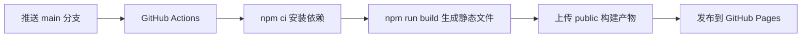

<h1 align="center">Jayson Blog</h1>

<p align="center">
  记录技术、生活与思考的个人博客
</p>

<p align="center">
  <a href="https://f-jayson.github.io/blog/">在线访问</a>
  ·
  <a href="https://github.com/F-Jayson/blog/actions/workflows/pages.yml">部署状态</a>
  ·
  <a href="https://github.com/F-Jayson/blog/issues">问题反馈</a>
</p>

<p align="center">
  <a href="https://github.com/F-Jayson/blog/actions/workflows/pages.yml">
    
  </a>
  
  
  
</p>

## 项目概览

这是一个基于 [Hexo](https://hexo.io/) 构建、使用 [Butterfly](https://github.com/jerryc127/hexo-theme-butterfly) 主题的个人博客。文章与配置保存在 Git 仓库中，提交到 `main` 分支后，由 GitHub Actions 自动生成静态文件并发布至 GitHub Pages。

在线地址：[https://f-jayson.github.io/blog/](https://f-jayson.github.io/blog/)

## 主要能力

| 功能 | 说明 |
| --- | --- |
| 静态站点生成 | 使用 Hexo 将 Markdown 文章转换为静态页面 |
| 响应式主题 | Butterfly 提供首页、文章、归档、分类和标签页面 |
| 自动部署 | 推送到 `main` 后自动构建并发布至 GitHub Pages |
| 本地搜索 | 生成 `search.json`，无需独立搜索服务 |
| 内容订阅 | 自动生成 Atom 订阅文件 |
| 搜索引擎支持 | 提供站点地图、Open Graph 和结构化数据 |
| 访问体验 | 支持深色模式、图片懒加载、代码高亮和自定义 404 页面 |

## 技术栈

| 组件 | 版本或用途 |
| --- | --- |
| Node.js | 20 或更高版本 |
| Hexo | 8.1.2 |
| Butterfly | 5.7.0 |
| GitHub Actions | 持续集成与自动部署 |
| GitHub Pages | 静态站点托管 |
| Markdown / YAML | 文章编写与站点配置 |

## 目录结构

```text
.
├── .github/
│   ├── dependabot.yml          # 依赖更新策略
│   └── workflows/pages.yml     # GitHub Pages 部署流程
├── scaffolds/                  # Hexo 文章、页面和草稿模板
├── source/
│   ├── _posts/                 # Markdown 文章
│   ├── categories/             # 分类页面
│   ├── tags/                   # 标签页面
│   └── img/                    # 站点图片资源
├── _config.yml                 # Hexo 全局配置
├── _config.butterfly.yml       # Butterfly 主题配置
├── package.json                # 脚本与依赖
└── package-lock.json           # 依赖版本锁定文件
```

`public/` 和 `db.json` 是构建过程中生成的文件，已被 Git 忽略，不需要提交。

## 本地开发

### 环境要求

- Node.js 20.19.0 或更高版本
- npm 10 或更高版本
- Git

### 获取项目

```bash
git clone https://github.com/F-Jayson/blog.git
cd blog
npm ci
```

使用 `npm ci` 可以严格按照 `package-lock.json` 安装依赖，使本地环境与 GitHub Actions 保持一致。

### 启动预览

```bash
npm run server
```

启动后访问 [http://localhost:4000/blog/](http://localhost:4000/blog/)。修改文章或配置后，Hexo 会自动刷新页面。

### 生成静态文件

```bash
npm run clean
npm run build
```

构建结果会输出到 `public/` 目录。

## 内容创作

创建新文章：

```bash
npx hexo new post "文章标题"
```

新文章位于 `source/_posts/`。推荐为每篇文章填写完整的 front-matter：

```yaml
---
title: 文章标题
date: 2026-08-07 20:00:00
updated: 2026-08-07 20:00:00
description: 用一句话概括文章内容。
categories:
  - 技术
tags:
  - Hexo
  - GitHub Pages
---
```

分类用于描述文章所属的主要领域，标签用于标记文章涉及的具体主题。文章发布后，相关分类页、标签页、搜索索引、站点地图和 Atom 订阅会同步更新。

## 自动部署



部署工作流也支持在 GitHub Actions 页面手动触发。首次启用时，需要在仓库的 `Settings > Pages` 中将构建来源设置为 **GitHub Actions**。

## 配置说明

| 文件 | 用途 |
| --- | --- |
| `_config.yml` | 站点信息、URL、目录、文章规则、分页、站点地图和 Atom 配置 |
| `_config.butterfly.yml` | 导航、图片、侧栏、搜索、主题样式、SEO 和第三方功能 |
| `.github/workflows/pages.yml` | 构建环境、命令、产物上传和 Pages 部署 |
| `.github/dependabot.yml` | npm 依赖的自动检查频率和 PR 数量限制 |

站点部署在 GitHub Project Pages 子路径下，以下配置需要保持一致：

```yaml
url: https://f-jayson.github.io/blog
root: /blog/
```

修改 YAML 文件时应使用空格缩进，不要使用 Tab。提交前建议至少执行一次 `npm run build`。

## 生成内容

构建完成后，站点会提供以下公共资源：

- `/blog/sitemap.xml`：搜索引擎站点地图
- `/blog/atom.xml`：Atom 内容订阅
- `/blog/search.json`：本地搜索索引
- `/blog/404.html`：自定义错误页面

## 内容授权

除文章中另有说明外，博客内容采用 [CC BY-NC-SA 4.0](https://creativecommons.org/licenses/by-nc-sa/4.0/) 许可协议。转载时请注明作者和原文链接，并遵守相同方式共享及非商业使用要求。

本仓库源代码目前未单独声明开源许可证。

## 反馈

如发现页面错误、失效链接或内容问题，请通过 [GitHub Issues](https://github.com/F-Jayson/blog/issues) 提交反馈。
